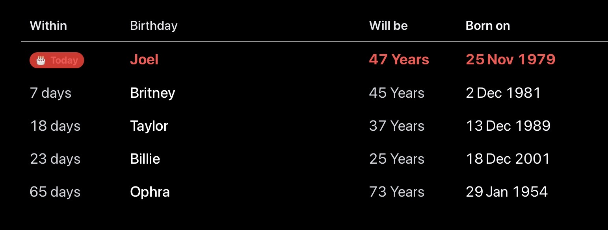

# MMM-Birthdays

A [MagicMirror²](https://magicmirror.builders/) module that displays upcoming birthdays, the number of days remaining, the age the person will turn, and their birth date.

Derived from [`BIRTHDAYS` (`anniversarymodule`)](https://github.com/marcomerens/anniversarymodule) by Marco Merens.

## Features

- Automatically sorts upcoming birthdays and limits the number of shown entries (`limit`).
- Highlights birthdays occurring today (`isToday`) with a subtle cake icon and accent styling.
- Displays `Today`, `1 day` / `1 dag`, or `<n> days` / `<n> dagen`.
- Shows the age the person will reach on their next birthday and their birth year.
- Uses separate locale files in `locales/` (`nl.js`, `en.js`) based on MagicMirror's global `config.language` setting (with fallback to `en`).

## Installation

1. Navigate to your MagicMirror `modules` directory:

    cd ~/MagicMirror/modules

2. Clone the repository:

    git clone https://github.com/jms3700/MMM-Birthdays.git

## Configuration

Add the module to your `~/MagicMirror/config/config.js` file:

    {
    	module: "MMM-Birthdays",
    	position: "top_right",
    	config: {
    		limit: 4,
    		showHeader: true,
    		people: [
    			{ name: "Marco", birthdate: "1973-12-30" },
    			{ name: "Anna", birthdate: "1985-04-12" }
    		]
    	}
    }

### Configuration Options

| Option | Type | Default | Description |
| :--- | :--- | :--- | :--- |
| `limit` | `number` | `4` | Maximum number of upcoming birthdays displayed. |
| `showHeader` | `boolean` | `true` | Shows or hides the table column headers. |
| `people` | `array` | `[{ name: "Marco", birthdate: "1973-12-30" }]` | List of people with `name` and `birthdate` (`YYYY-MM-DD`). |

## Adding or Editing Languages

Language texts and month abbreviations live in separate files inside `locales/`:

- `locales/nl.js` (used when MagicMirror's `config.language` starts with `nl`, e.g. `nl` or `nl-be`)
- `locales/en.js` (default fallback for other languages)

To add another language (for example `fr.js`):

1. Copy `locales/en.js` to `locales/fr.js`.
2. Translate the strings and month names inside `window.MMMBirthdaysLocales.fr`.
3. Add `"fr"` to `supportedLanguages` in `MMM-Birthdays.js`.

## License

MIT — see the `LICENSE` file for details. Originally derived from work by Marco Merens.
